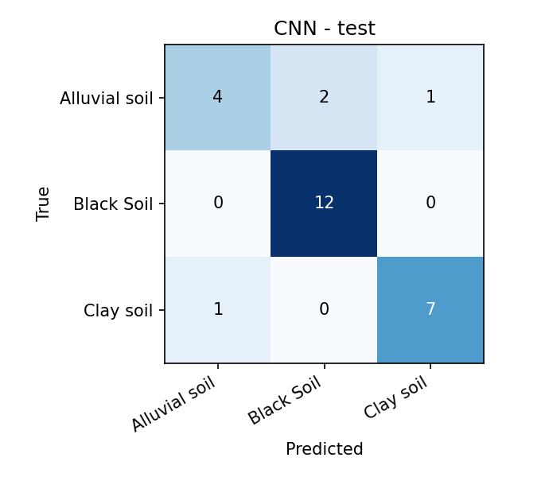
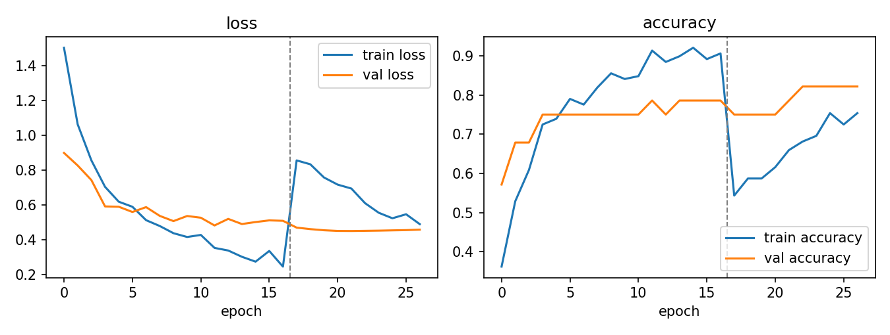

# Soil Image Classification


A reproducible pipeline for classifying soil type from photos: Alluvial, Black, and Clay soil.

The project covers the full ML engineering loop on a small, messy, real-world dataset:

1. **Data audit.** Finds exact and near-duplicate images, flags photos filed under two labels, and builds a stratified, group-aware train/val/test split with zero leakage.
2. **Classical baseline.** Color and texture features (HSV histograms, Lab moments, LBP, GLCM) with scikit-learn. Model selection uses the validation split; the test split is scored once.
3. **CNN.** MobileNetV2 transfer learning: frozen-backbone head training, then partial fine-tuning, with augmentation and class weighting.
4. **Evaluation.** Accuracy, balanced accuracy, macro-F1, per-class metrics, confusion matrices, and bootstrap 95% confidence intervals, because a 28-image test set is noisy.
5. **Compression and benchmarking.** TFLite fp32 / fp16 / dynamic-range int8 export, each re-scored on the test set with model size and p50/p95 CPU latency.
6. **Serving.** A CLI (`soilclf predict`) and a Streamlit app, both using the same image loader as training, so there is no train/serve skew.

Every step is a command-line call driven by one config file (`configs/default.yaml`) and a fixed seed. Tests and CI cover the pipeline.

## Quick start

```bash
git clone https://github.com/Madkinny/soil-image-classification.git
cd soil-image-classification
make install-train          # pip install -e ".[train,app,dev]"
# put the dataset at Datasets/<class name>/*.jpg
make all                    # audit -> baseline -> train -> evaluate -> export
make app                    # Streamlit demo
```

No local GPU? Use [`notebooks/colab_train.ipynb`](notebooks/colab_train.ipynb).

Individual steps:

```bash
soilclf audit
soilclf baseline
soilclf train
soilclf evaluate
soilclf export
soilclf predict path/to/photo.jpg --model artifacts/cnn/model_fp16.tflite
soilclf --set train.epochs_head=5 --set seed=7 train     # override any config value
```

## Data audit

The raw dataset contains 235 images collected from the web. `soilclf audit` found:

| Class | Files found | Used after cleaning |
|---|---|---|
| Alluvial soil | 54 | 49 |
| Black Soil | 116 | 91 |
| Clay soil | 65 | 53 |
| **Total** | **235** | **193** |

- **40 exact duplicates removed**, e.g. `images398.jpg`, `Copy of images398.jpg`, `Copy of images398(1).jpg`.
- **8 near-duplicate groups** (re-encoded, re-cropped, or re-shot photos of the same scene) are each kept inside a single split.
- **1 label conflict**: the same stock photo appears as both Alluvial and Clay soil. Both copies are dropped.
- **Split:** 138 train / 28 val / 27 test, stratified by class, **0 duplicate groups shared between splits**.
- **The split is frozen** in [`reports/manifest.csv`](reports/manifest.csv). `soilclf audit` verifies that the files and bytes still match and reuses it, because `StratifiedGroupKFold` gave a different split under a different scikit-learn version (77 of 193 images moved). Use `--resplit` to create a new one.

Why this matters: with a plain random split, copies of the same photo land in both train and test, and test accuracy measures memorization instead of generalization.

Near-duplicate detection uses a 256-bit difference hash plus a thumbnail correlation check. The thresholds were set by inspecting candidate pairs in this dataset: true duplicates sat at ≤ 15 differing bits, or 32 bits with r = 0.985 for a re-shot photo, while unrelated photos sat at ≥ 30 bits with r < 0.82. An earlier average-hash version wrongly merged three different Black Soil photos with an Alluvial photo, which is why it was replaced.

Full report: [`reports/data_audit.md`](reports/data_audit.md).

## Results

Held-out test split (n = 27), seed 42, trained on a Colab T4 GPU in 98 seconds. Results were produced by commit `6ff9347`.

| Model | Accuracy (95% CI) | Macro-F1 (95% CI) | Recall: Alluvial / Black / Clay |
|---|---|---|---|
| Baseline: color/texture features + Random Forest | 0.778 (0.630–0.926) | 0.730 (0.534–0.883) | 3/7 · 12/12 · 6/8 |
| **MobileNetV2 transfer learning** | **0.852 (0.704–0.963)** | **0.822 (0.634–0.962)** | 4/7 · 12/12 · 7/8 |

- The CNN improves on the baseline mainly in Alluvial and Clay soil, but **the confidence intervals overlap**. With 27 test images, this run cannot show that the CNN is significantly better. More data would be needed for that.
- Alluvial soil is still the hard class for both models. It is the smallest class and is visually close to Clay soil.
- On validation (n = 28), the CNN reached 0.786 accuracy. Only 1 of 27 test images fell below the 60% confidence threshold.

<p>
  
  
</p>

### Training curves and a fine-tuning bug



The dashed line marks the switch from head training to fine-tuning the top 30 backbone layers. At that point, train accuracy dropped from 0.91 to 0.54 even though the learning rate was only 1e-5. That points to BatchNorm layers switching to training mode on small batches, not to the weight updates. The backbone was called with `training=False`, but that alone did not keep BatchNorm frozen. `cnn.unfreeze_top` now keeps every BatchNorm layer explicitly frozen during fine-tuning, and a unit test checks it. The numbers above are from the run *before* this fix; they will be updated after the next training run.

### Compression and latency

Same 27 test images, single-image CPU inference with 1 thread on Colab:

| Variant | Size (MB) | Test accuracy | Macro-F1 | Latency p50 (ms) | Latency p95 (ms) |
|---|---|---|---|---|---|
| Keras (`.keras`) | 21.90 | 0.852 | 0.822 | 156.6 | 220.5 |
| TFLite fp32 | 8.90 | 0.852 | 0.822 | 8.6 | 13.1 |
| **TFLite fp16** | **4.52** | **0.852** | **0.822** | **8.5** | **12.9** |
| TFLite int8 (dynamic range) | 2.53 | 0.852 | 0.822 | 20.7 | 24.1 |

- **No accuracy was lost** in any compressed variant on this test set.
- **fp16 is the best trade-off:** 4.8× smaller than the Keras file and as fast as fp32. The app and CLI default to it.
- **int8 dynamic-range is the smallest (8.6× smaller) but 2.4× slower** on this CPU. Its weights are stored as int8, but activations stay in float, so the hybrid kernels pay a conversion cost. Full-integer quantization with a calibration set would be the next step if size matters more than latency.
- The Keras latency includes per-call Python and eager-execution overhead, so it is not a like-for-like kernel comparison. It shows what a naive serving loop costs.

## Project layout

```
configs/default.yaml        all hyperparameters, paths, thresholds, seed
src/soilclf/
  data.py                   scanning, de-duplication, near-duplicate grouping, splits
  images.py                 the one image loader used everywhere (RGB, EXIF-aware)
  features.py               handcrafted color/texture features
  baseline.py               scikit-learn baseline with validation-based model selection
  cnn.py                    MobileNetV2 model, tf.data pipeline, two-phase training, evaluation
  export.py                 TFLite conversion and latency benchmark
  metrics.py                metrics, bootstrap CIs, confusion-matrix plots
  cli.py                    `soilclf` command
app/streamlit_app.py        demo app (serves the fp16 TFLite model)
notebooks/colab_train.ipynb run everything on Colab
reports/                    committed outputs: audit, manifest, metrics, figures
tests/                      pytest suite on a synthetic dataset with planted duplicates
```

## Design decisions

- **The split is grouped by near-duplicate cluster, not by file.** This is the single most important choice for honest metrics on this dataset.
- **Preprocessing lives inside the model.** A `Rescaling` layer maps RGB [0, 255] to MobileNetV2's [-1, 1], so the CLI, the app, and TFLite all feed raw RGB and cannot get the color order or scaling wrong.
- **The test set is scored once.** Baseline model choice and CNN early stopping use the validation split only.
- **Confidence intervals are always reported.** With 27 test images, one image is about 3.7 accuracy points.
- **Library versions are saved with every metrics file.** The Random Forest baseline can shift by one test image between scikit-learn/OpenCV versions; logistic regression reproduced exactly.
- **The app abstains below 60% confidence** and warns the user instead of always forcing one of 3 labels.

## Limitations

- Small, web-scraped dataset: 193 usable images and only 27 test images, imbalanced (Black Soil is 47%), some watermarked stock photos.
- The images are not standardized field samples, so the model may learn photo style as much as soil properties.
- The dataset is not redistributed here. Use your own copy in `Datasets/`.

## Development

```bash
make install    # core + pytest, no TensorFlow
make test
```

CI runs the test suite twice: without TensorFlow (data, features, metrics, baseline, frozen-split validation) and with TensorFlow (BatchNorm freezing, plus an end-to-end train → evaluate → export → predict smoke test on synthetic images).

Built with the help of an AI coding agent (Claude Code). The data audit thresholds and every reported number come from running the code in this repository.

## License

MIT
