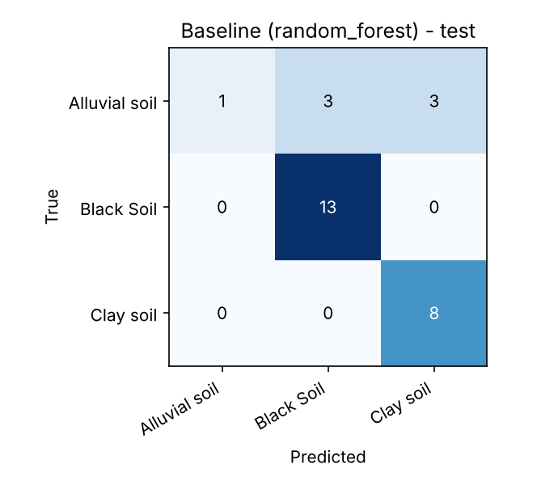

# Soil Image Classification


A reproducible pipeline for classifying soil type from photos: Alluvial, Black, and Clay soil.

The project covers the full ML engineering loop on a small, messy, real-world dataset:

1. **Data audit.** Finds exact and near-duplicate images, flags photos filed under two labels, and builds a stratified, group-aware train/val/test split with zero leakage.
2. **Classical baseline.** Color and texture features (HSV histograms, Lab moments, LBP, GLCM) with scikit-learn. Model selection uses the validation split; the test split is scored once.
3. **CNN.** MobileNetV2 transfer learning: frozen-backbone head training, then partial fine-tuning, with augmentation and class weighting.
4. **Evaluation.** Accuracy, balanced accuracy, macro-F1, per-class metrics, confusion matrices, and bootstrap 95% confidence intervals, because a 28-image test set is noisy.
5. **Compression and benchmarking.** TFLite fp32 / fp16 / dynamic-range int8 export, each re-scored on the test set with model size and p50/p95 CPU latency.
6. **Serving.** A CLI (`soilclf predict`) and a Streamlit app, both using the same image loader as training, so there is no train/serve skew.

Every step is a command-line call driven by one config file (`configs/default.yaml`) and a fixed seed. Tests and CI cover the pipeline.

## Quick start

```bash
git clone https://github.com/Madkinny/soil-image-classification.git
cd soil-image-classification
make install-train          # pip install -e ".[train,app,dev]"
# put the dataset at Datasets/<class name>/*.jpg
make all                    # audit -> baseline -> train -> evaluate -> export
make app                    # Streamlit demo
```

No local GPU? Use [`notebooks/colab_train.ipynb`](notebooks/colab_train.ipynb).

Individual steps:

```bash
soilclf audit
soilclf baseline
soilclf train
soilclf evaluate
soilclf export
soilclf predict path/to/photo.jpg --model artifacts/cnn/model_int8_dynamic.tflite
soilclf --set train.epochs_head=5 --set seed=7 train     # override any config value
```

## Data audit

The raw dataset contains 235 images collected from the web. `soilclf audit` found:

| Class | Files found | Used after cleaning |
|---|---|---|
| Alluvial soil | 54 | 49 |
| Black Soil | 116 | 91 |
| Clay soil | 65 | 53 |
| **Total** | **235** | **193** |

- **40 exact duplicates removed**, e.g. `images398.jpg`, `Copy of images398.jpg`, `Copy of images398(1).jpg`.
- **8 near-duplicate groups** (re-encoded, re-cropped, or re-shot photos of the same scene) are each kept inside a single split.
- **1 label conflict**: the same stock photo appears as both Alluvial and Clay soil. Both copies are dropped.
- **Split:** 138 train / 27 val / 28 test, stratified by class, **0 duplicate groups shared between splits**.

Why this matters: with a plain random split, copies of the same photo land in both train and test, and test accuracy measures memorization instead of generalization.

Near-duplicate detection uses a 256-bit difference hash plus a thumbnail correlation check. The thresholds were set by inspecting candidate pairs in this dataset: true duplicates sat at ≤ 15 differing bits, or 32 bits with r = 0.985 for a re-shot photo, while unrelated photos sat at ≥ 30 bits with r < 0.82. An earlier average-hash version wrongly merged three different Black Soil photos with an Alluvial photo, which is why it was replaced.

Full report: [`reports/data_audit.md`](reports/data_audit.md). The exact split is in [`reports/manifest.csv`](reports/manifest.csv).

## Results

All numbers are on the held-out test split (n = 28), seed 42.

| Model | Accuracy (95% CI) | Macro-F1 (95% CI) | Notes |
|---|---|---|---|
| Baseline: color/texture features + Random Forest | 0.786 (0.642–0.929) | 0.663 (0.510–0.840) | Alluvial recall 1/7 |
| MobileNetV2 transfer learning | pending first full run | | `make train evaluate` |

The baseline is near-perfect on Black and Clay soil but misses 6 of 7 Alluvial images, so color and texture statistics alone don't separate Alluvial from the other two. That is the gap the CNN has to close.



### Compression

`soilclf export` writes [`reports/export/report.md`](reports/export) with size, test accuracy, macro-F1, and single-image CPU latency for the Keras model and the three TFLite variants.

## Project layout

```
configs/default.yaml        all hyperparameters, paths, thresholds, seed
src/soilclf/
  data.py                   scanning, de-duplication, near-duplicate grouping, splits
  images.py                 the one image loader used everywhere (RGB, EXIF-aware)
  features.py               handcrafted color/texture features
  baseline.py               scikit-learn baseline with validation-based model selection
  cnn.py                    MobileNetV2 model, tf.data pipeline, two-phase training, evaluation
  export.py                 TFLite conversion and latency benchmark
  metrics.py                metrics, bootstrap CIs, confusion-matrix plots
  cli.py                    `soilclf` command
app/streamlit_app.py        demo app (prefers the int8 TFLite model)
notebooks/colab_train.ipynb run everything on Colab
reports/                    committed outputs: audit, manifest, metrics, figures
tests/                      pytest suite on a synthetic dataset with planted duplicates
```

## Design decisions

- **The split is grouped by near-duplicate cluster, not by file.** This is the single most important choice for honest metrics on this dataset.
- **Preprocessing lives inside the model.** A `Rescaling` layer maps RGB [0, 255] to MobileNetV2's [-1, 1], so the CLI, the app, and TFLite all feed raw RGB and cannot get the color order or scaling wrong.
- **The test set is scored once.** Baseline model choice and CNN early stopping use the validation split only.
- **Confidence intervals are always reported.** With 28 test images, one image is about 3.6 accuracy points.
- **The app abstains below 60% confidence** and warns the user instead of always forcing one of 3 labels.

## Limitations

- Small, web-scraped dataset: 193 usable images, imbalanced (Black Soil is 47%), some watermarked stock photos.
- The images are not standardized field samples, so the model may learn photo style as much as soil properties.
- The dataset is not redistributed here. Use your own copy in `Datasets/`.

## Development

```bash
make install    # core + pytest, no TensorFlow
make test
```

CI runs the test suite twice: without TensorFlow (data, features, metrics, baseline) and with TensorFlow (an end-to-end train → evaluate → export → predict smoke test on synthetic images).

Built with the help of an AI coding agent (Claude Code). The data audit thresholds and every reported number come from running the code in this repository.

## License

MIT
